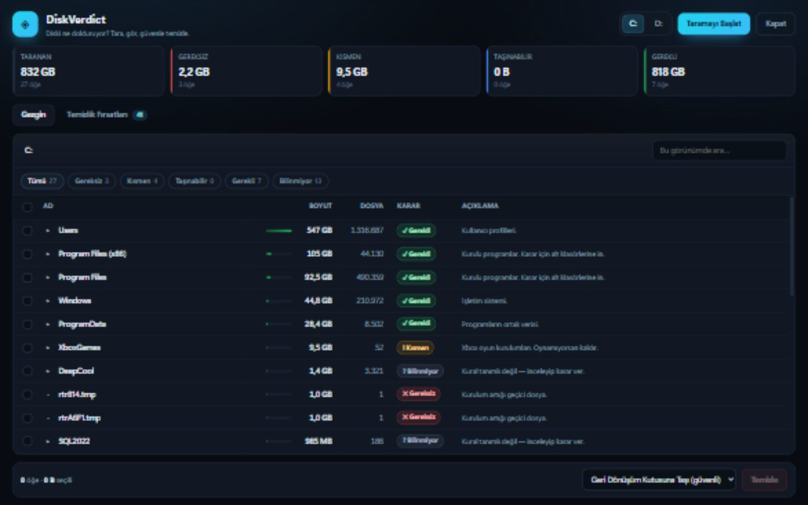

# DiskVerdict

**A Windows disk analyzer that doesn't just show sizes — it tells you what each folder *is*.**

WizTree, TreeSize and WinDirStat answer "what's big?". DiskVerdict also answers "can I delete it?" — every folder gets a verdict with a one-line reason, and the whole drive gets a ranked cleanup list.

Zero dependencies. Node.js stdlib only. No installer, no admin rights, no telemetry.

**[Download DiskVerdict.exe](https://github.com/akupelikilinc/DiskVerdict/releases/latest)** — one ~100 MB file with Node.js embedded. No runtime to install; double-click it.



```
┌──────────────────────────────────────────────────────────────────┐
│  TARANAN   986 GB      GEREKSİZ  2.2 GB     TEMİZLİK FIRSATI  44 │
├──────────────────────────────────────────────────────────────────┤
│  Users                           700 GB   ✓ keep     profiles    │
│  Program Files (x86)             105 GB   ✓ keep     installed   │
│  XboxGames                       9.5 GB   ! partly   uninstall?  │
│  rtr814.tmp                      1.0 GB   ✕ junk     temp file   │
└──────────────────────────────────────────────────────────────────┘
```

## Why

Size sorters leave you guessing. Is the 80 GB folder a game you play or a VM image you forgot? DiskVerdict classifies every folder into five buckets — **keep**, **move**, **partly removable**, **junk**, **unknown** — and explains each one in a sentence. You review the verdicts, not a wall of numbers.

## Features

- **One-pass scan.** 445k folders / 2.1M files on a full C: drive in ~2 minutes, with live progress.
- **Verdicts per folder**: keep / move / partly removable / junk / unknown, plus a short reason.
- **Cleanup opportunities**: the biggest removable items merged into one ranked list, parents and children de-duplicated.
- **Safe delete**: recycles to the Recycle Bin by default (shell32 `SHFileOperation`), with permanent delete behind an explicit choice and a confirmation dialog listing every path.
- **Explorer view**: breadcrumbs, search, verdict filters, size bars, file counts.
- **Turkish and English** — pick TR or EN in the header; the choice is remembered and verdict reasons follow it.
- **Symlink/junction aware**: links are skipped, so no double counting and no loops.
- **Locked system files** (`pagefile.sys`, `hiberfil.sys`, `System Volume Information`) show `—` instead of a fake `0 B`; no admin prompt needed.

## Requirements

- Windows 10 or 11
- Chrome or Edge for the app window (falls back to the default browser)
- Only when running from source: Node.js 18+

## Run

Double-click `DiskVerdict.exe` from the [latest release](https://github.com/akupelikilinc/DiskVerdict/releases/latest), or run from source:

```bat
DiskVerdict.bat
```

or

```bat
npm start
```

The server binds `127.0.0.1:8777` (increments if busy) and opens a borderless app window. Double-clicking the launcher again while it runs re-attaches to the running instance instead of starting a second, empty one.

Stop it with the **Kapat / Close** button in the UI — that shuts the server down; closing the window alone leaves it running.

## How classification works

`RULES` in `server.js` is an ordered list of regex → verdict + reason, written against real folder layouts (caches, package managers, SDKs, game launchers, VM images, installers, logs, dumps). First match wins; anything unmatched is **unknown**, on purpose — the tool would rather ask than guess.

Adding a rule is one line:

```js
{ m: /\\appdata\\local\\foo\\cache$/, v: 'bad', c: 'Önbellek', w: 'Foo derleme önbelleği. Yeniden oluşturulur.', e: 'Foo build cache. Regenerated on demand.' },
```

Verdicts are advisory. Nothing is deleted without selection, a confirmation, and (by default) a trip through the Recycle Bin.

## Self-test

```bat
npm test
```

Asserts size aggregation, junction protection, and the classifier over real-world path samples.

## Build the exe

```bat
npm run build
```

Repacks the current `node.exe` with Node's SEA support and injects `server.js`, `public/*` and `tools/recycle.ps1` into `build\DiskVerdict.exe` (needs Node.js 20+; `postject` is fetched by `npx`). The exe is unsigned, so Windows SmartScreen may ask once.

## Notes

- Sizes are **apparent** size. Hardlinked WinSxS payloads and compressed files make the total read ~3% above what Windows reports as used.
- Scan results live in memory; restarting the server means rescanning. That's deliberate — it never reads your disk unless asked.
- UI is Turkish and English — pick TR or EN in the header; the choice is remembered and reasons come from the server in the same language.

## License

MIT
